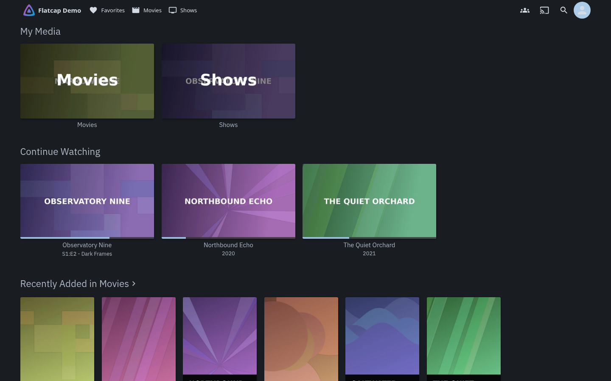
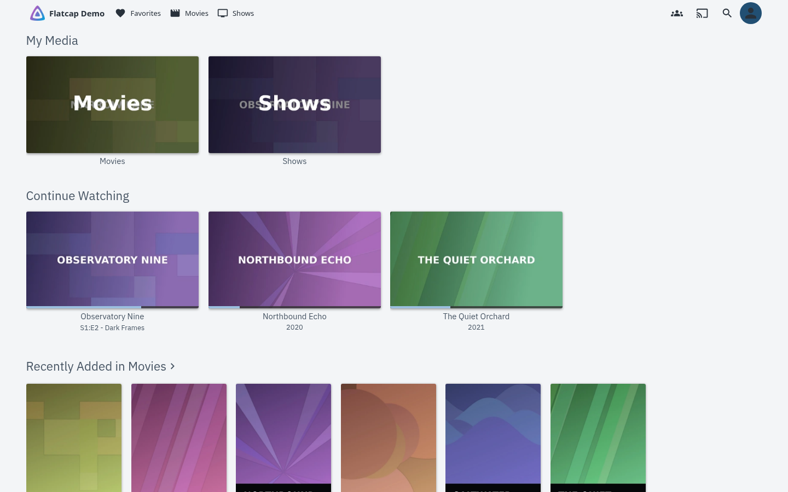
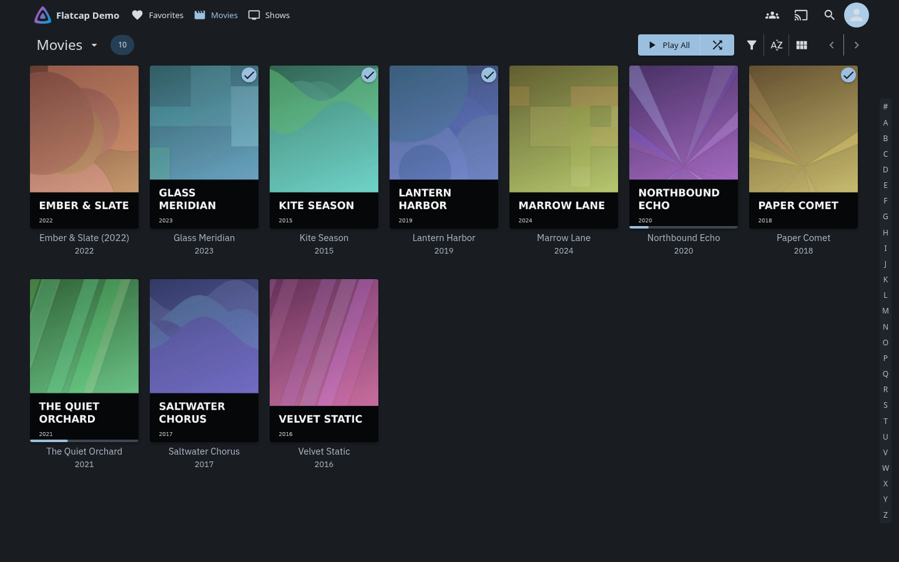
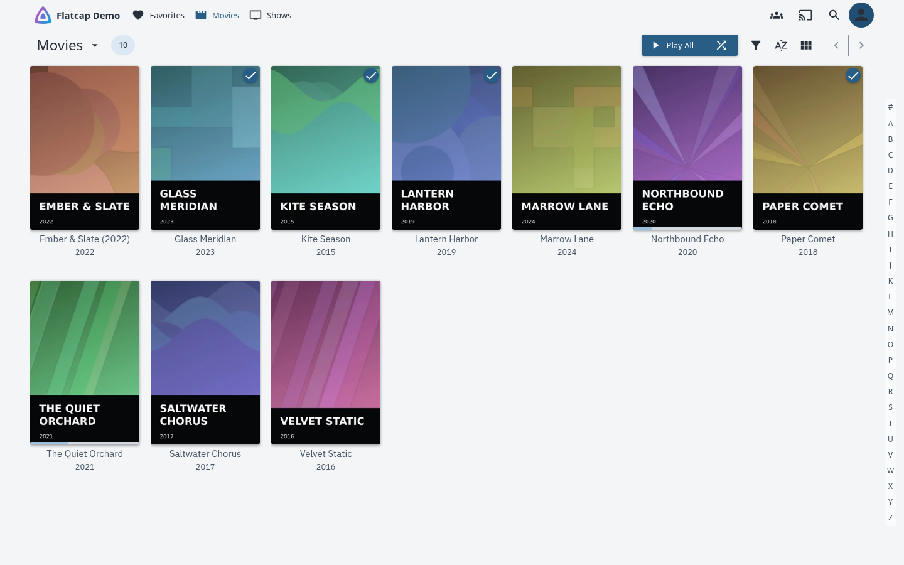
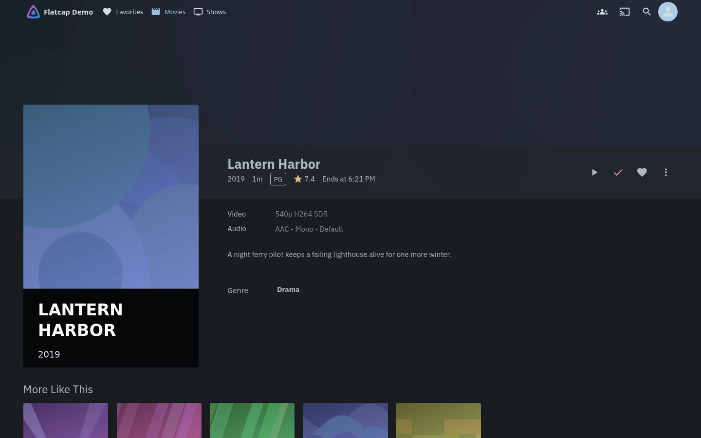
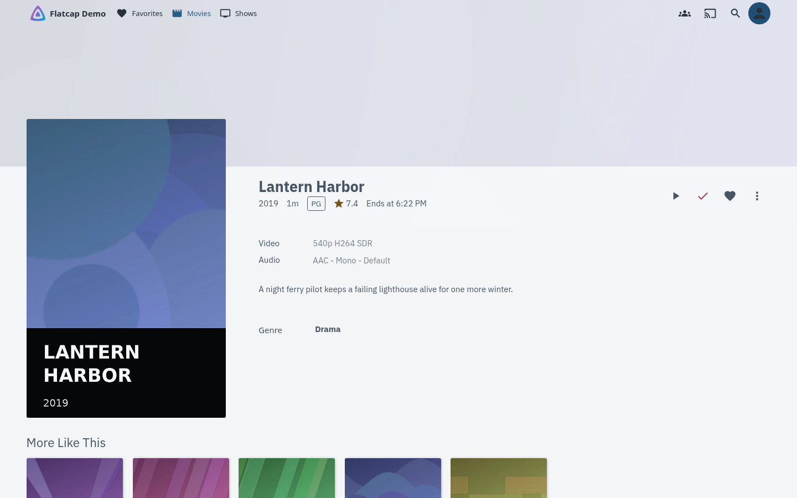
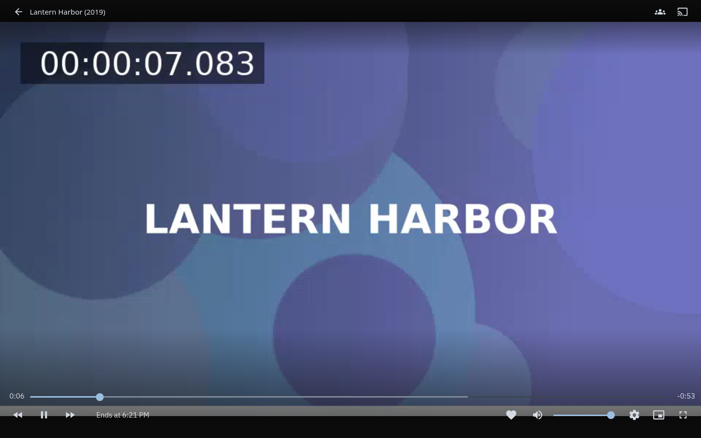
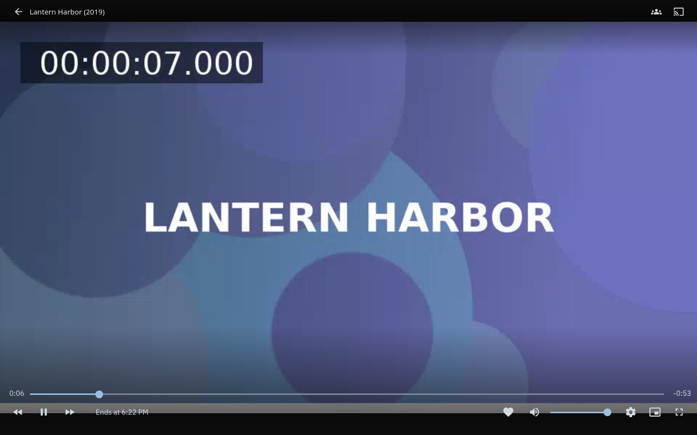

# Flatcap for Jellyfin

  

  

  

Flatcap Slate (dark) above, Flatcap Daylight (light) below, on a Jellyfin 12.4.0 demo library (synthetic titles and artwork).

<table>
  <tr>
    <td width="50%"></td>
    <td width="50%"></td>
  </tr>
  <tr>
    <td></td>
    <td></td>
  </tr>
  <tr>
    <td></td>
    <td></td>
  </tr>
  <tr>
    <td align="center">Slate</td>
    <td align="center">Daylight</td>
  </tr>
</table>

**Flatcap for Jellyfin** brings the Flatcap visual system to your media server: quiet graphite (or soft light) surfaces behind your posters, one mineral-blue accent, IBM Plex Sans for the interface.

It is three plain CSS files to paste into Jellyfin's **Custom CSS** box: **Flatcap Slate** (dark), **Flatcap Daylight** (light) and **Flatcap system**, which follows the device's light or dark setting. Every color comes from the Flatcap 2.0 core. No plugin, no build step on your server.

> The interface organizes. Content takes the foreground. Color informs.

## Install

Requires **Jellyfin 12.4** or newer (checked against the web client bundled with 12.4.0).

1. Open one of the files in [`themes/`](https://github.com/cheycron/flatcap-jellyfin/tree/main/themes) and copy all of it.
2. In Jellyfin: **Dashboard → Branding**, paste into **Custom CSS code**, and save. The CSS is stored in `branding.xml` (`<CustomCss>`) and sent to every web client.
3. Reload the web client. Every user must use the **Dark** theme (*Settings → Display → Theme*; Dark is Jellyfin's default). All three files are written for Dark as the base theme.

Paste only one file. Do not paste Slate and Daylight together.

Pasting is required: an `@import` of the raw GitHub URL does **not** work. `raw.githubusercontent.com` answers with `Content-Type: text/plain` and `X-Content-Type-Options: nosniff`, and a browser refuses to load a stylesheet with that type (checked, see the [QA report](https://github.com/cheycron/flatcap-jellyfin/blob/main/docs/qa-report.md)). The Jellyfin 12.4 web client itself sets no Content-Security-Policy that would block it; the file type does.

## Use it

<!-- build:themes -->
<!-- /build:themes -->

- **Slate** and **Daylight** are fixed modes. **System** holds both sets and switches with `prefers-color-scheme` (Slate, or Daylight when the device is light).
- The video player on-screen controls, the resume bar on posters and the volume popups stay on the dark Slate palette in every file: they sit on video or artwork, so a light Daylight panel there would be unreadable.
- Each user can switch the custom CSS off for themselves (*Settings → Display*, "Disable custom CSS" in 12.4) and can add their own CSS on top.
- **The server Dashboard (administration pages) does not receive Branding Custom CSS in 12.4.0**: every `/dashboard/*` route checked kept Jellyfin's stock styling. Home, libraries, item pages, search, the player and *Settings* (user preferences) are themed.

## Fonts

<!-- build:fonts -->
<!-- /build:fonts -->

See the [Flatcap typography guide](https://github.com/cheycron/flatcap-theme/blob/main/docs/typography.md).

## Accessibility

Contrast is checked for the pairs Jellyfin actually combines (text on each surface, links and active tabs, buttons and badges with their fill, focus ring, inputs, alerts, toasts and dialogs, the header over a bright backdrop, the on-screen player controls over a bright and a dark video frame, the resume bar over a poster) against the contracts of the [Flatcap core](https://github.com/cheycron/flatcap-theme): 7:1 for primary text, 5:1 for informative text, 3:1 for functional outlines and focus, 4.5:1 for text on fills. `python3 scripts/build.py --check` fails if any pair misses its target.

Limits that affect you: these are token-level numbers measured on the values the CSS sets. They do not prove how every Jellyfin page renders. The unfilled and buffered parts of the player's seek bar, Jellyfin's own poster and video scrims, user-uploaded artwork, TV guide category colors and a few legacy widgets keep Jellyfin's colors. Jellyfin has no increased-contrast setting, so this port ships the standard contrast set only. Keyboard and TV-layout focus stays visible: cards and controls get an added 2px focus-ring outline (tested in the TV layout).

Every mapping is in [docs/mapping.md](https://github.com/cheycron/flatcap-jellyfin/blob/main/docs/mapping.md); the measured ratios and the before/after scan are in the [QA report](https://github.com/cheycron/flatcap-jellyfin/blob/main/docs/qa-report.md).

## Compatibility

- Variable and selector names were verified against the web client bundled with Jellyfin 12.4.0 (`ghcr.io/linuxserver/jellyfin:12.4ubu2604-ls57`). Another release can add or rename variables; `scripts/inventory.py` rebuilds the inventory from any release.
- Rendering was checked in Chromium (Playwright) at 1440×900. Firefox, Safari, the desktop apps, Android and TV clients were not tested. Native (non-web) Jellyfin clients do not use the web Custom CSS at all.
- The CSS does not change layout, sizes or animations. The one removal is the decorative `backdrop-filter: blur(5px)` on the volume/brightness popup (`.iconOsd`).
- Not themed: the Dashboard (see above); the TV guide's category colors, legacy folder-tree and context-menu widgets, and the placeholder card colors for items without artwork. See the [residual defaults](https://github.com/cheycron/flatcap-jellyfin/blob/main/docs/qa-report.md).

## Contributing

`themes/*.css` and the generated README and docs blocks are produced from `src/theme.json`; do not edit them by hand. Change values in the Flatcap core and refresh them with `python3 scripts/build.py --sync`; mapping changes must name a variable and class that exist in `src/jellyfin-inventory.json`. Run `python3 scripts/build.py --check` before opening a pull request. Mapping details are in [docs/mapping.md](https://github.com/cheycron/flatcap-jellyfin/blob/main/docs/mapping.md).

## License

MIT © Cheycron Blaine. See [LICENSE](https://github.com/cheycron/flatcap-jellyfin/blob/main/LICENSE).

## Support

If Flatcap makes your workspace calmer, you can support its development.

  

